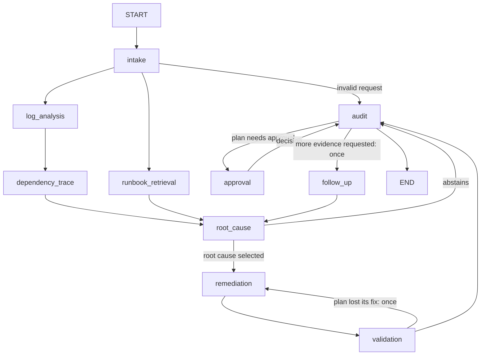

# Architecture

FlowGuard is one Python service. A LangGraph graph runs each investigation, MCP servers provide its evidence, Qdrant indexes its documents, a local model proposes hypotheses and plans, and SQLite keeps the audit trail and paused investigations.

```mermaid
flowchart LR
    client[Client or demo] -->|HTTP| api[FastAPI]
    api --> graph[LangGraph investigation]
    graph -->|checkpoints| ckpt[(SQLite: paused investigations)]
    graph -->|every stage| audit[(SQLite: audit versions)]
    graph -->|hypotheses, plans| ollama[Ollama: gemma4:12b]
    graph -->|tool calls, through a guard| mcp[MCP clients]
    mcp --> obs[Observability server]
    mcp --> ops[Operations server]
    mcp --> know[Knowledge server]
    know -->|search| qdrant[(Qdrant)]
    obs & ops & know --> data[(Seeded data)]
```

## The investigation graph



| Node | What it does |
|---|---|
| `intake` | Validates the request as an `Incident`. An invalid request goes straight to the audit, with errors that never repeat the rejected value. |
| `log_analysis` | Searches logs in the incident window and marks the earliest error as the first failure. |
| `runbook_retrieval` | Searches runbooks, API specs, and past incidents for the affected system. Runs in parallel with log analysis. |
| `dependency_trace` | Gathers changes from the 24 hours before the first failure: deployments, alerts, and metrics, at the failing service or upstream of it on the dependency map. |
| `root_cause` | Since 2026-11-11, the explain path (`graph/nodes/explain.py`): Gemma says what failed, seeing only the symptoms, then which change, if any, explains it. Code accepts a category only with a cited log, abstains on an isolated, uncategorised or unexplained failure, and lets an explaining change correct the category but never into `deployment_or_configuration`. The earlier way, `diagnosis="hypotheses"`, has Gemma propose up to three hypotheses that code scores with the rubric, selecting one only at 0.65 or above. |
| `remediation` | Gemma proposes up to five steps, chosen from the action catalogue. |
| `validation` | Deterministic. Refuses any step that isn't catalogued, cites unknown or unrelated evidence, targets something not in the evidence, or runs before a fix it depends on. Attaches risk, rollback, verification, and approval from the catalogue. |
| `audit` | Saves a new version of the record. Runs at the end of every path. |
| `approval` | Pauses the graph with `interrupt()` until a person decides. Validates the decision it receives. |
| `follow_up` | After "request more evidence": searches with the reviewer's comment and starts a fresh round of reasoning. |

Every loop is bounded: two plan attempts, one follow-up round, and a step limit of 40 per run against about ten for a normal investigation.

## Evidence

All evidence comes through MCP, so every tool call goes through the same guard, validation, redaction, and audit.

| Server | Tools |
|---|---|
| Observability | `search_logs`, `search_alerts`, `get_alert`, `get_metrics` |
| Operations | `get_deployments`, `get_incident`, `search_incidents` |
| Knowledge | `get_dependency_map`, `get_api_spec`, `search_runbooks` |

The servers run in the same process, through in-memory MCP clients. Each investigation opens its own clients and its own `ToolGuard`, so call limits and tool history are never shared between investigations. The graph decides which tools run, with fixed arguments; the model never calls a tool.

Documents are chunked by section (API specs) or kept whole (runbooks and past incidents), embedded with `BAAI/bge-small-en-v1.5`, and searched in Qdrant with a filter on the system and on current documents, applied before the result limit. Results below a similarity of 0.6 are dropped; the threshold was chosen with a retrieval evaluation (`python -m flowguard.evaluation.retrieval`).

## Confidence

The model never sets a confidence. Code adds up fixed signals from the evidence a hypothesis cites:

| Signal | Points |
|---|---|
| Cites an error log | +0.30 |
| A cited change (deployment, alert, or metric crossing its threshold) came before the first failure, within 24 hours | +0.20 |
| A cited change is at or upstream of the failing service | +0.15 |
| Cites an API specification | +0.15 |
| Cites a deployment | +0.10 |
| Cites a similar past incident | +0.10 |
| Each contradicting piece of evidence | −0.20 |
| Each evidence source that failed or was cut short | −0.15 |

The score is clamped to 0–1 and rounded before it's compared with 0.65.

## State, checkpoints, and audit

- **Graph state** is a typed dictionary. Evidence and errors use a reducer that joins updates from parallel nodes.
- **Checkpoints** are saved after every node to a SQLite file, so a paused investigation survives a restart. Loading a checkpoint rebuilds only FlowGuard's own model classes.
- **The audit store** keeps every version of every record. `(investigation_id, version)` is unique, so two decisions racing to save the same version can't both succeed, and the loser gets 409.

## Main design decisions

Each is explained, with the reasons, in [`brief.md`](../brief.md) and [`CHANGELOG.md`](../CHANGELOG.md).

- **A local model.** `gemma4:12b` through Ollama, chosen after comparing it with `gemma4:e4b` on INC-001. The client is behind a small `LLM` protocol, so another provider can replace it.
- **Category on the hypothesis, not a triage node.** The incident's category comes from the selected root cause, so it's decided with all the evidence.
- **One `POST /investigations`** instead of the brief's two incident routes. It waits for the result, because the approval pause already makes long-running work resumable.
- **The rubric counts any change, not only deployments.** Otherwise a cause that isn't a release, such as an expired credential, could never reach the threshold.
- **Recommend, don't execute.** An approved plan is recorded. Running actions is outside the MVP.
